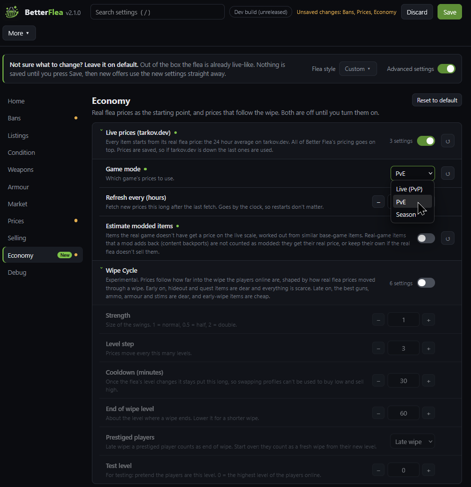
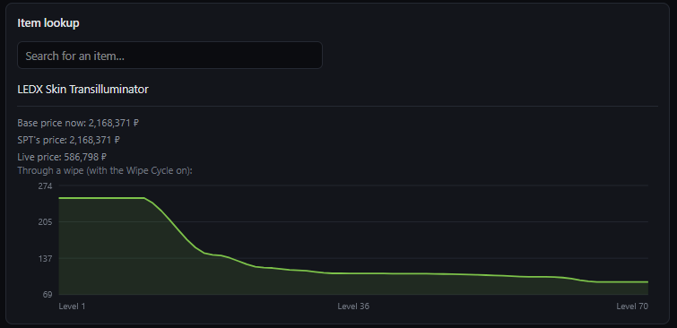

# How prices work

[Back to the guide](README.md)

Three prices meet on the flea: SPT's **handbook price**, SPT's **flea price**, and what **traders pay**. This page
explains each one, how SPT turns them into an offer, the flea fee, and what Better Flea does instead. Numbers are
from SPT 4.1.6 and its shipped config.

## SPT's two price tables

| Table | File | What uses it |
|---|---|---|
| **Handbook** | `SPT_Data/database/templates/handbook.json` | What traders pay you, the in-game handbook, quest and insurance maths, and SPT's fallback when there's no flea price |
| **Flea prices** | `SPT_Data/database/templates/prices.json` | The base price of every generated flea offer, and the "item worth" in the flea fee |

**The handbook is no guide to what an item sells for.** On the real flea the median item sells for about twice its
handbook price, and a third are more than 3x off (a Vulkan-5 helmet has an 8k handbook price and sells for 400k to
900k). It's a trader-side number.

**`prices.json` is mostly replaced at startup.** SPT 4.1's shipped `configs/ragfair.json` has
`dynamic.generateBaseFleaPrices.useHandbookPrice: true`. With it on, when the server starts SPT rewrites every item's
flea price as:

```
flea price = handbook price x (1.5, or the item type's own multiplier) + handbook price x 0.8 if the item is used in a hideout craft
             and never under the most a trader pays for it
```

Keycards get 2.5, money 1, and the Dorm 314 marked key 1.8 (`itemTypeMultiplierOverride`, `itemTplMultiplierOverride`).
So in plain SPT 4.1 the flea runs on the handbook too, scaled up. That's why SPT's flea prices and the real flea
disagree badly for some items: a 275k FN SCAR-H X-17 that really sells for 17k, a 503k jar of pickles that sells for
53k. About 12% of items are more than 3x off. [Research: price sources compared](../Research/price-sources-compared.md)

## How SPT prices a generated offer

For each offer SPT takes the item's flea price, then:

1. **Multipliers:** `dynamic.itemPriceMultiplier` for a few items.
2. **A random spread:** `dynamic.priceRanges`, 0.8 to 1.2 for most offers, 0.75 to 0.96 for packs, 0.95 to 1.05 for
   presets. In whole-percent steps, so a dozen offers land on the same price, and one 20% under normal sits at the top
   of nearly every list.
3. **Condition:** less left, cheaper. Durability counts by its square root, on the outer item only. Built-in armour
   inserts aren't counted at all, so a helmet at 6/14 was priced as new.
4. **Guns:** a preset is priced as the sum of its parts (`generatePresetPriceByChildren`).
5. **Silly-price caps:** a weapon part priced over 6x its handbook price is cut to 6x, an electronic item over 11x
   to 11x (`dynamic.unreasonableModPrices`). Mostly hits modded items.
6. **Trader floor:** with `useTraderPriceForOffersIfHigher`, never under the most a trader pays. In plain SPT that
   check counted traders that buy nothing (the BTR Driver, Lightkeeper, the Storyteller), who appear to pay the full
   handbook price for everything, so many items were floored at their handbook price.

## What traders pay

A trader pays a cut of the item's **handbook price**, and only for the kinds of item it buys (`items_buy` in each
trader's `base.json`). Each loyalty level has a `buy_price_coef`, the share the trader keeps:

```
trader pays = handbook price x (100 - buy_price_coef) / 100, less for a worn item
```

| Trader | SPT 4.1 (the 0.16.9 numbers) | Live since patch 1.1 |
|---|---|---|
| Therapist | 63% | 51% |
| Ragman | 62% | 50% |
| Jaeger | 60% | 48% |
| Mechanic | 56% | 45% |
| Prapor | 50% | 40% |
| Skier | 49% | 39% |
| Peacekeeper | 45% (in dollars) | 36% |
| Fence | 40% | 24% |
| Ref | 50 / 56 / 56 / 62% by loyalty level | 40 / 45 / 45 / 50% |

Ref is the only trader whose payout rises with your loyalty level. Everyone else pays the same at every level.

SPT 4.1 is built on EFT 0.16.9, and its trader cuts match 0.16.9 exactly. BSG cut every trader's payout by about a
fifth in patch 1.1 (August 2026). Better Flea's **Live trader prices** (Economy tab, on by default) uses the live
cuts; turn it off for SPT's. The cuts are exact percentages: live trader prices are the base price times the cut,
rounded down, on about 97% of items.

**Live and SPT base prices differ for about 1 item in 10.** BSG has changed some base prices since 0.16.9 (meds about
20% cheaper, cosmetic face covers set to 5,000, some armour reworked), and SPT 4.1 has the 0.16.9 ones. For those items
a trader pays the live cut of the old base price. The other 90% match live to the rouble.

**Other mods:** a trader whose cuts another mod has changed (SVM's Trader markup, say) keeps that mod's cuts, and the
server log names it. SVM's defaults are SPT's own, so they don't count as a change. SVM writes one cut for every
loyalty level, so with its Traders section on and Live trader prices off, Ref pays SVM's one rate at every level.

## The flea fee

SPT copies the game's own fee formula. For one item:

```
VO = the item's worth: its flea price (the base price above), plus its parts', less for wear and used uses
VR = the price you ask (times the count, unless sold as one pack)
PO = log10(VO / VR)      PR = log10(VR / VO)
     whichever of the two is positive is raised to the power 1.08
fee = (VO x 0.03 x 4^PO + VR x 0.03 x 4^PR) x (1 - your hideout and skill discount)
```

Asking more than an item is worth makes the second half grow fast, which is why overpricing costs real money. For an
item worth 47k listed at 66k the fee is about 3,500; listed at 47k, about 2,800. The 3% rates are `communityItemTax` and `communityRequirementTax` in
`globals.json`. With Better Flea pricing on, the item's worth is Better Flea's base price.

## What Better Flea does instead

Every generated offer, and the "normal price" a player's own listing is measured against, goes through the same
steps:

| Step | What happens | Where to change it |
|---|---|---|
| 1. Base price | Better Flea's price index (default), live tarkov.dev prices, or SPT's, then your own price if you set one | Economy tab |
| 2. Condition | Key uses, amount left, durability; armour by its inserts and max durability | Condition and Armour tabs |
| 3. Guns | Valued from trader prices by how hard each part is to unlock, parts at their own flea price | Prices tab, Guns |
| 4. Drift and demand | A slow wander per item; rises when people buy it, small drops when they sell a lot | Prices tab |
| 5. Floor | Never under the best trader's price (traders that really buy the item only) plus 10% | Prices tab, Floor |
| 6. Spread | Ordinary offers 4% under to 15% over normal | Prices tab, Spread |
| 7. Sellers | Overpricers, rare quick sells, troll prices, wrecked armour just under the cheapest decent offer | Prices tab, Sellers |
| 8. Multipliers | The global price multiplier and the marked key multiplier, and the Wipe Cycle | Prices and Economy tabs |
| 9. Human prices | To the rouble, often an easy number: 45,000, 49,999, 44,444, a rouble under the next seller | Prices tab, round prices |

### The price index

Better Flea ships one fixed price for every base-game item, built from a year of real flea price history (PvP, with
PvE where PvP has none; keys get a value between the two), with bait listings, thin markets and junk worked out. It
doesn't move from day to day; drift and demand do that on top. Think of it as a more reliable handbook. It's built
once by a script and shipped inside the mod, so your server never needs the internet for it.
[How it's built](../Research/price-index.md)

Rules the index follows that matter for players:
- **Anyone who can buy an item from a trader caps its flea price.** Over a trader's cash price, only a share of the
  difference is kept, by how hard the item is to unlock: nothing for an easy unlock, a fifth at loyalty 3, half at
  loyalty 4, up to 90% behind a very hard quest. [The quest tree](06-quest-tree.md)
- **Never under the best trader buy price**, or players would just sell to the trader.
- **Ammo packs** are priced as their rounds. **Guns** are priced so their default build costs what it really sells for.
- **Flea-banned items** ignore old flea history from before the ban.

### Live prices

The other option: every item starts from tarkov.dev's 24-hour average for PvP, PvE or the season. Prices are saved,
so an outage uses the last ones. One day's prices are noisy (on one day, one item in five was 3x apart between PvP and
PvE; over a year, 53 of 2,868), which is why the index is the default.



*Live prices on the Economy tab.*

### Your prices

Economy tab, **Your prices**: set any item's base price yourself. It replaces the index, live or SPT price at step 1,
so drift, condition and multipliers still apply. A gun's price is the gun on its own; its parts are priced
separately. Not sure what number to use? Look up a similar base-game item in Item lookup and start from its base
price.

### The floor

No generated offer goes under the most a trader pays for the item, plus 10%. Otherwise anyone could buy on the flea and
sell straight to that trader for profit. Only traders that actually buy that kind of item count, and the floor counts
everything in the offer (plates, inserts, parts).

When a **modded trader sells an item for less than another trader pays** (Artem sells the SF High Cut for 65k and
Ragman pays about 72k), the floor keeps every flea offer of it over Ragman's price, so the trader stays the cheapest.
The unsupported **No floor for trader loops** setting (Prices tab, advanced) drops the floor for items like that only.

## Seeing it all for one item

Economy tab, **Item lookup**: search an item to see its base price now, SPT's price, Better Flea's price, the live
price, its actual value as one would be listed, its [sale odds](07-selling.md#sale-odds), and how its price would move
through a wipe.



*Item lookup on the Economy tab.*
