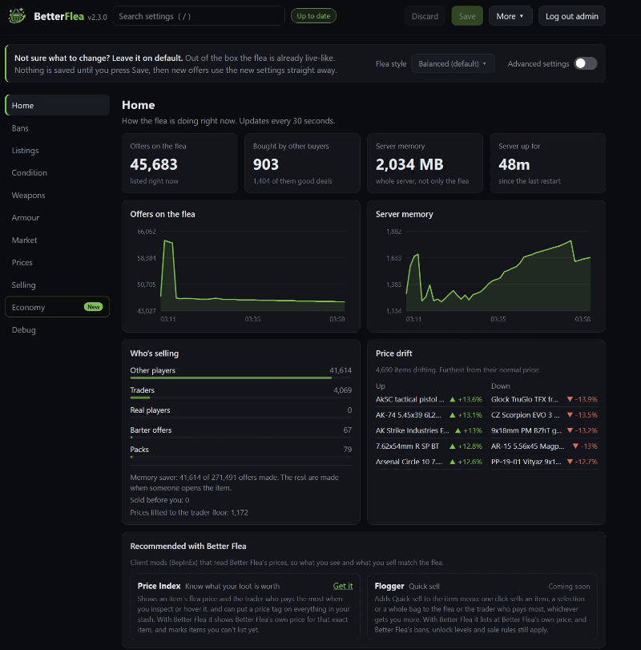
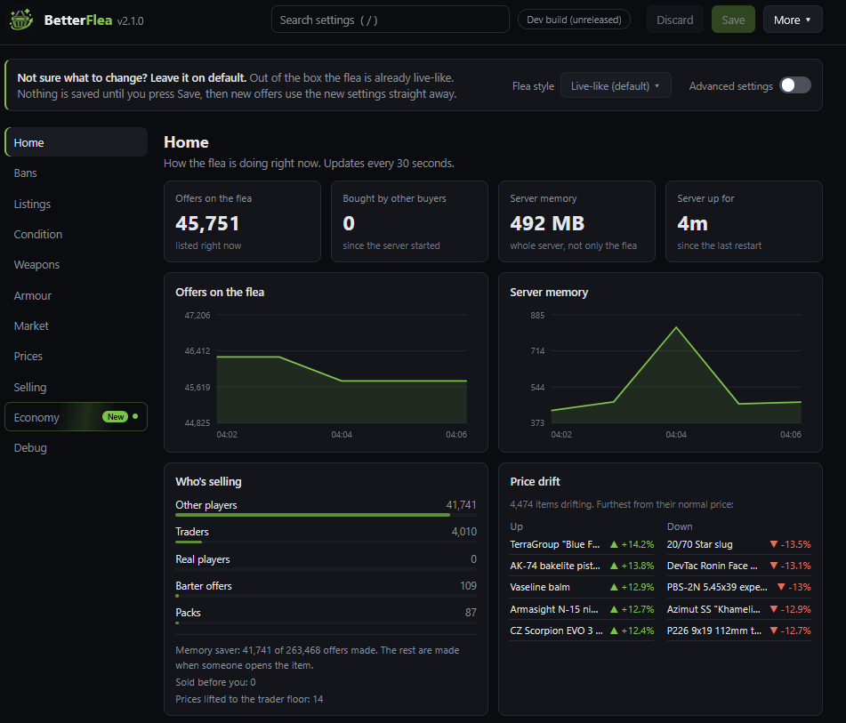
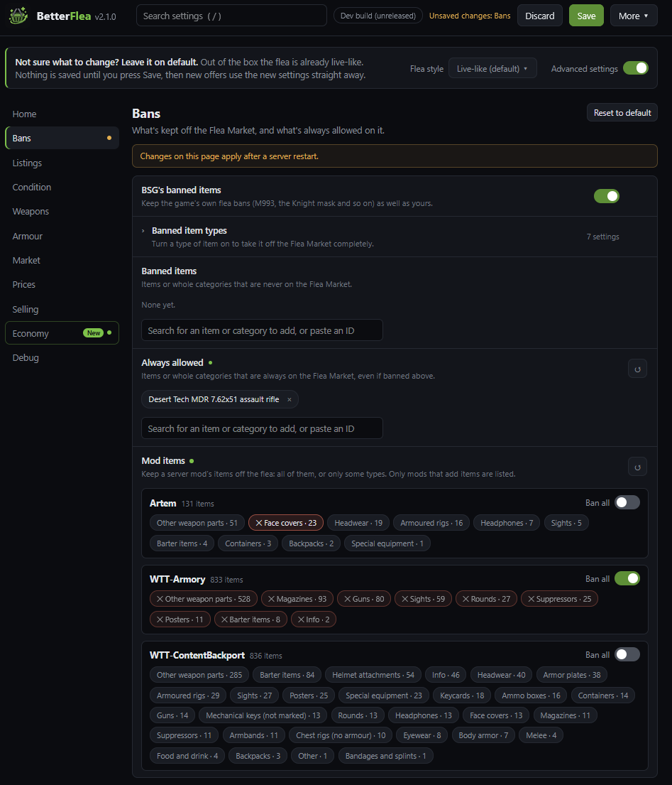
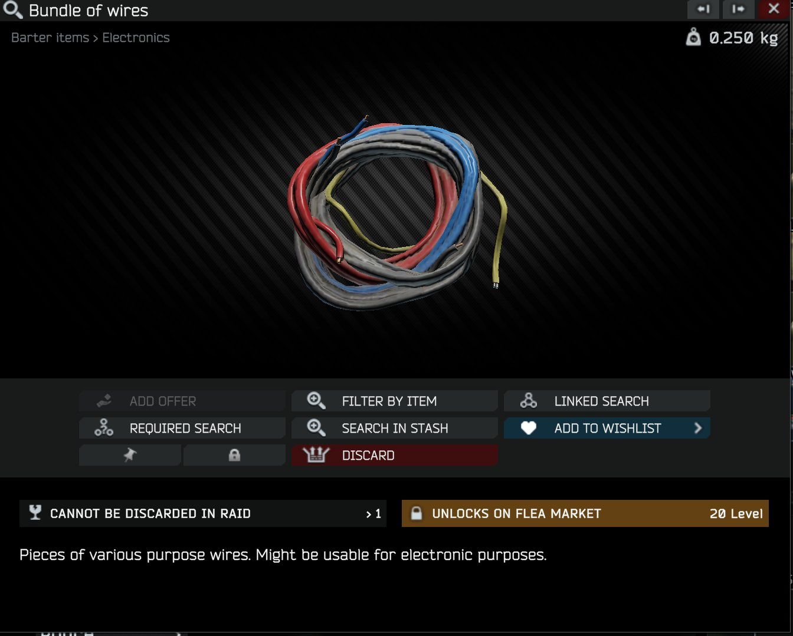
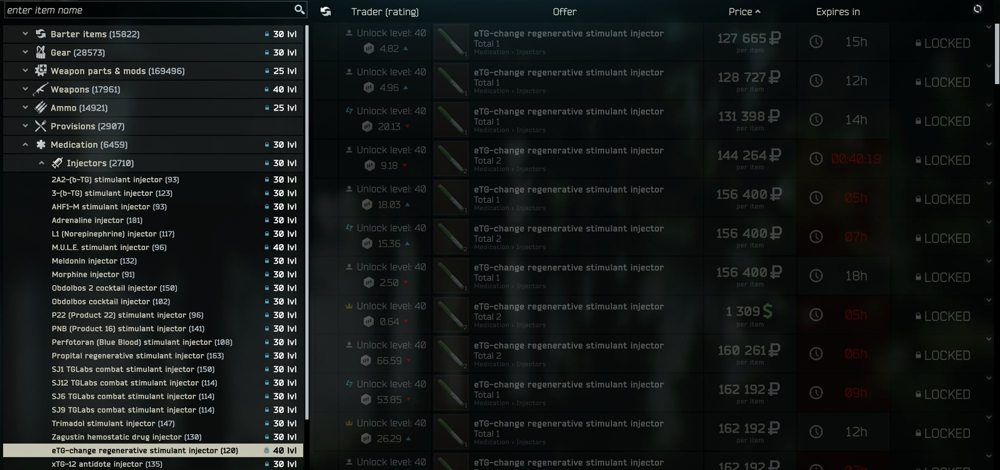
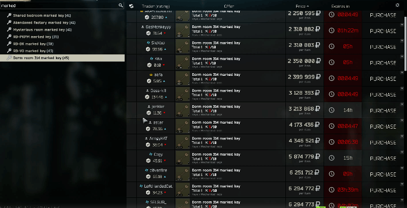
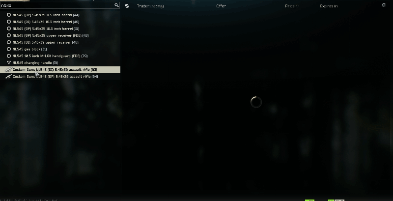
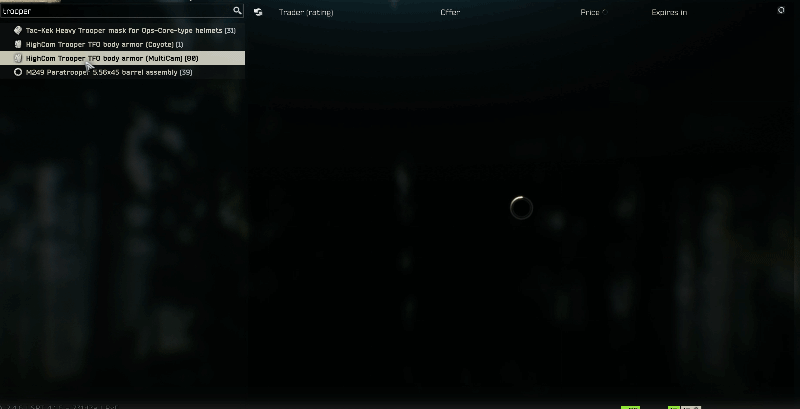
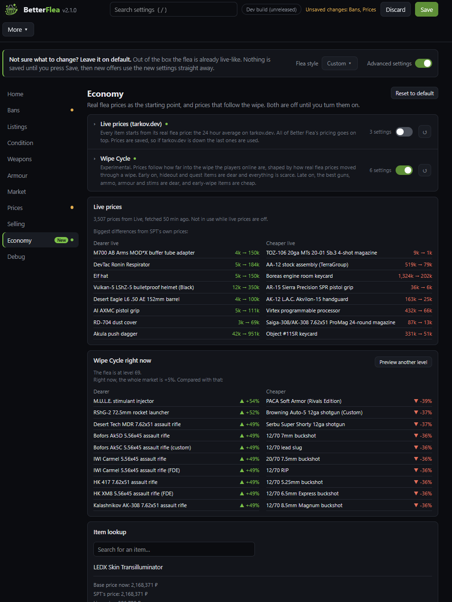

# Better Flea

**Makes the flea better (duh). More live-like, much more balanced, and highly configurable.**

Better Flea makes the Flea Market in SPT better. Yeah that's the best I could come up with :) :

- Guns are listed the way players actually sell them: stripped, stock, found, budget, modded and meta builds, broken-down guns, and guns looted off scavs and bosses. Priced against what traders sell them for.
- Your own guns turn up: builds you save, and guns you die with, sold by whoever killed you.
- Body armour comes with realistic plates, and gear comes in every condition from mint to wrecked.
- Offers look real: a normal number of items in each offer, partly used keys, meds, food and fuel, and the odd scam to watch out for.
- A living market: offers last up to 24 hours, other players buy the good deals, sellers have flea ratings and Edge of Darkness or Unheard badges, and now and then something is "sold before you".
- Selling depends on your price: undercut and it sells fast, overprice and it sits there. Flipping is slowed down.
- Item unlock levels like live (optional): the M4A1 from level 25, a graphics card from 40, shown in game like live.
- Prices change a little over time. An offer is never cheaper than what a trader pays for the item.
- Turn off whole groups of items on the Flea Market.
- 3 times the base game's offers, with about the same server memory as SPT without the mod.
- A settings page in your browser: search for any setting, pick a flea style, ban a whole mod's items, and see how the flea is doing.

Everything can be turned off or tuned in the settings.

**Recommended with Better Flea:** [Price Index](https://sp-mod.com/mod/3228/price-index) shows what your loot is worth in game, and [Flogger](https://sp-mod.com/mod/3227/flogger) quick sells it to the flea or the best trader. Both read Better Flea's own prices (2.3.0 or newer), so what you see and what you sell match the flea.

## What you need
- SPT 4.1.x. Fika compatible.
- Better Flea has 2 parts. **The server needs part 1. Every real player needs part 2.**

| Part | Folder | Who installs it |
|---|---|---|
| 1. Server mod | `SPT_Runtime\user\mods\BetterFlea\` | The server |
| 2. BepInEx plugin | `BepInEx\plugins\BetterFlea\` | Every player |

**Fika headless client: do NOT install the BepInEx plugin on it.** It only needs the server mod on the server.

## How to install
1. Download `BetterFlea-2.2.0.zip`.
2. Open your SPT install folder.
3. Extract the zip into this folder. The 2 parts go to the correct folders by themselves.
4. Only the server host needs the server component. Obviously. Every REAL player needs the BepInEx plugin.

## How to update
Close the game and the server, extract the new zip over the old one, and start the server. Your settings are kept, and any new settings are added with their defaults.

## How to uninstall
Delete these 2 folders:
- `SPT_Runtime\user\mods\BetterFlea\`
- `BepInEx\plugins\BetterFlea\`

Better Flea does not change player profiles. You do not need to clean anything else.

## Settings
Everything is changed on the settings page: open `https://127.0.0.1:6969/betterflea` on the server PC, or click it under **Mod Pages** in the SPT launcher. From another PC use the server's address. The first visit asks you to make an admin account, and changing settings needs that login. Everyone else sees the flea's stats.

Every setting is explained right there, and most changes apply as soon as you press Save. Please don't edit the files in the `configs` folder by hand.

Changed something and want it back? Press Reset to default on that tab, or Reset everything in the More menu.

Forgot the password? Delete `SPT_Runtime/user/mods/BetterFlea/data/admin.json` and restart the server, then make a new account. Your settings are kept.

Flea styles change everything at once. **Balanced** is the default: live-like, without item unlock levels or the Wipe Cycle. **Live progression** is Balanced plus item unlock levels and the Wipe Cycle (prices follow the wipe, experimental), as close to the live flea as it gets. There are also Base SPT (Better Flea's changes off), Rough market, Overpriced, Flea sale, Chaos, Random and Low memory.







## 1. Bans
- BSG's own flea bans stay on (M993, Knight's Mask and so on - shameless plug go install my Knight Mask fix mod).
- Take whole types of items off the flea: guns, ammo, keys, armour, meds and the rest.
- Ban single items, or always allow them even if their type is banned. Search for them by name.
- Ban the items another server mod adds: all of them, or just some types (only its guns, say).
- Item unlock levels (off by default; the Live progression flea style turns them on, or the Bans tab): some items can only be bought and sold from a certain level (the M4A1 from 25, a graphics card from 40). Items show the level they unlock at when inspected and flea categories show a lock, like live. Uses the real game's levels. A modded item unlocks with the real items of its kind that are worth about the same, so a strong modded stim needs the level the strongest real stims need. With Advanced settings on, you can set your own level for any item or whole category.



*An item's inspect window says the level it unlocks on the Flea Market.*



*Flea categories show the level they open at, and offers you can't buy yet show locked. Shown on a low-level profile.*

## 2. Offers

### How many offers
Base SPT feels too empty to me on the Flea, this pumps it up. 3 times the offers by default.

- More offers for one type of item, or a minimum per item.
- Most offers are only made when someone looks at the item, so the server uses about as much memory as SPT without the mod. Short on RAM? Pick the Low memory flea style.

### Items in one offer
Makes offers more like the live flea - for example wires you will see a lot more of one type listed but something like Bulbex won't have 8 in one listing as they are much rarer, players usually don't have that many to flog.

### Partly used items
I personally hate seeing marked keys listed with full durability. I then also dislike having a 1/x use key being half the price of a 2/x. In live, players usually try and flog it for a bit more - it's annoying but more realistic :)

- Keys, meds, food, fuel and repair kits are sometimes partly used. Less left = cheaper.
- Used items are one per offer. Full ones sometimes come a few at a time.
- Some fuel cans are empty. Most are cheap, some are priced like a full one.



## 3. Guns and armour

### Gun builds
Guns aren't just SPT's factory builds. Each gun offer is one of these:

| Build | What it is |
|---|---|
| Stripped | The good stuff sold off: scope, suppressor, lights, nice stock. |
| Stock | Factory gun, maybe a part or two changed. |
| Ground loot | Picked up off the ground and sold as found. |
| Found | Looks like it came out of a raid, some exactly as a scav or boss carries it. |
| Budget | A full build from cheap parts. |
| Modded | A proper build. Some are the gun's meta build. |
| Broken | Main parts taken off. |
| Gutted | Nearly everything sold off. |

- Cheap guns are mostly stripped or broken, dear guns mostly modded. Gun wear matches the build.
- Want an exact build to show up (a streamer's, say)? Save it in the game's Builds screen with a name starting with "Meta".
- Some guns and magazines have rounds in them.



### Players' own guns
- Builds you save in the Builds screen can turn up on the flea.
- Die in a raid and your gun might turn up a while later, sold by whoever killed you.

### Armour
- Armour and rigs come with both plates, one, or none, in every condition from mint to wrecked. Helmets and face shields too.
- Face shields, visors and night vision on helmets are sometimes listed flipped down.



## 4. Market
- Offers last up to 24 hours, like live. Good deals don't last long, overpriced ones sit there.
- Other players buy offers, and now and then something you try to buy was "sold before you".
- Seller ratings go up to 300 and grow with the players on the server: mostly low up to level 15, mostly high by level 40. Someone selling a stack of one item is usually a flipper with a high rating.
- Some sellers have an Edge of Darkness or Unheard badge, like live, and very rarely a special one. A seller keeps the same rating and badge on every offer.
- Rare barter offers that want items people actually have lying around.
- Packs: several items you have to buy together. Most are scams, so do the maths. Very rarely someone lists a silly amount.

## 5. Prices
I would personally recommend setting the marked key price to 1.5 as I feel marked keys a bit too cheap in base SPT. I've left this untouched for the default.

- An offer is never cheaper than what a trader pays for the item. No buying on the flea to sell to a trader.
- Prices go up and down over time.
- Supply and demand: buy up an item and its next offers get dearer for a while. Sell a lot of one item and now and then its price drops a little.
- Good deals are rare. Ordinary offers sit from a little under to a bit over the normal price, so there's no buying the top offer and selling it on for a profit. Some sellers ask too much, and now and then someone sells one cheap (it goes fast).
- Guns are priced against what traders sell them for, so a stock gun isn't 3 times the trader's price.
- Want the whole flea dearer or cheaper? One setting does every offer from other sellers. Trader prices don't change.

## 6. Player selling
I've tried to balance flipping, it's far too overpowered and it's very easy to just buy from Fence and resell. The trader item lock is off by default - turn it on and any item bought from a trader cannot be sold on the flea. Purchases are remembered while it's off too, so turning it on mid-wipe also locks what was bought before.

- How fast your offer sells depends on your price. Cheaper than normal sells in under a minute, the normal price takes a few minutes, overpriced rarely sells, and more than 15% over never does. "Normal" goes by what's in your item: armour with one plate is priced as armour with one plate.
- Price against the market. If another seller already has the item cheaper, most buyers go to them, and their offers sell before yours.
- A pile of one item often only partly sells: buyers take one or two, or a round lot of ammo.
- Undercutting: list the cheapest offer and now and then someone lists a rouble (or a round number) under you a few minutes later and takes most of your buyers. List well under the normal price and it sells before anyone bothers.
- Found in raid only is off by default, like live.

Well whats the difference between the flip penalty and the trader item lock?

| | Flip penalty | Trader item lock |
|---|---|---|
| **What happens** | The item **can** be sold. The player waits **longer** for a buyer. | The item can **never** be sold on the Flea Market. |
| **Which purchases** | Traders, Fence and the Flea Market | Traders and Fence |
| **When it starts** | After the player buys **many** of one item | From the **first** item |
| **Default** | On | Off |
| **The player sees** | Nothing. The item only sells slower. | A grey item and a warning |

## 7. Economy
- **Better Flea pricing (on by default):** every base-game item starts from Better Flea's own fixed price instead of SPT's, built from real PvP and PvE flea prices and trader prices with the junk taken out. It doesn't move; the rest of Better Flea's pricing goes on top. Modded items get a price worked out from similar base-game items, and the newer items WTT ContentBackport adds get Better Flea's price too (can be turned off). While it's on, live prices aren't used. How it's built: [Research/price-index.md](Research/price-index.md).
- **Live prices:** every item starts from its real flea price, the 24 hour average on tarkov.dev, and the rest of Better Flea's pricing goes on top. Pick Live, PvE or Season. Prices are saved, so if tarkov.dev is down the last ones are used. Modded items get a price worked out from similar base-game items. Items from content backport mods are real game items, so they get their real price.
- **Wipe Cycle (experimental):** prices follow how far into the wipe the players online are, based on how real flea prices moved through a whole wipe. Everything is dear right at the start, hideout and early quest items are dear before people get to them, and the best guns, ammo, armour and stims are dear late on. After the flea's level changes it stays put for 30 minutes, so swapping profiles can't be used to flip items. The Live progression flea style turns it on.

They're not made to run together, so you may run into issues if you turn both on.



## What the BepInEx plugin does
The server makes all the rules. The BepInEx plugin shows them to the player:

- **Flea Market icon on items.** Red = banned on the Flea Market (off by default). Orange = bought from a trader (on by default, only shows when the trader item lock is on). Hover the icon to see why. Change them in the **F12 menu** (BepInEx configuration manager).
- **These items are grey** when you add an offer on the Flea Market.
- **Item unlock levels (when on):** items show the level they unlock at when inspected, flea categories show a lock, and offers you can't buy yet show locked, like live.
- **Player listings turned off?** The sell button is greyed out and you get a small warning instead of the error that kicks you to the menu.
- **Quick-sell mods** sell these items to a trader. They do not try the Flea Market first.

A player without the plugin also cannot sell these items on the Flea Market. But that player sees a big error message, not the small warning.

## Modded items
Better Flea works from what an item is (its type, stats and price), not from lists of names, so it's built to handle items other mods add: guns, attachments, armour, meds and traders. I can't test every mod though, so if something modded looks wrong on the flea, let me know.

## Other mods
- **Mods that show prices or colour banned items** see Better Flea's bans correctly.
- **Price Index** shows Better Flea's prices with Better Flea 2.3.0 or newer. With an older version it shows the base game's prices.
- **Flogger** quick sells at Better Flea's prices with Better Flea 2.3.0 or newer, and Better Flea's bans, unlock levels and sale rules still apply.
- **Quicksell mods** should work with the BepInEx plugin. I have only tested with ShowMeTheMoney so please let me know of any issues for others.
- **All Quests Checkmarks** will still work. Better Flea adds its own icon and does not change or mess with it's icon.
- **SVM (Server Value Modifier) and other mods that change what traders pay:** with **Live trader prices** on (Economy tab), Better Flea sets what each trader pays to the live game's. A trader another mod has changed (SVM's Trader markup, say) keeps that mod's price instead, and the server log says which traders. SVM's default markups are SPT's own, so if you haven't changed them, Better Flea's live prices are used. To use SVM's for every trader, turn Live trader prices off.
- **Other mods that change the Flea Market** (number of offers, prices, items in one offer) can do the same thing as Better Flea. The mod that loads last usually wins. Turn off the same feature in one of the 2 mods.

## For mod developers
Your client mod can ask the server for Better Flea's data. The routes below are on the SPT server, need no login and are plain JSON (not zlib). From a BepInEx plugin, use SPT's `RequestHandler`, which sends the player's session for you. These routes and their shapes won't change without a note in the changelog.

If a route isn't there (an older Better Flea, or Better Flea not installed), the server answers with an error. Fall back to your own prices or data when that happens.

### Item price (Better Flea 2.3.0 or newer)
`POST /betterflea/item-price`

What Better Flea would sell one of the item for on the flea, in roubles, with every setting applied: the price multiplier, marked key multiplier, drift, Wipe Cycle, price floor, the item's condition and key uses, and gun pricing. It's the same price a player's own listing is measured against.

Send the item and everything in it (a gun's parts, a mag's rounds, an armour's plates) as a JSON list, the way the game stores them: root item first, with `_id`, `_tpl` and, for the parts, `parentId` and `slotId`. Add `upd` for condition, key uses or stack size. The item doesn't have to be in the player's stash.

```json
[{ "_id": "6720aaaaaaaaaaaaaaaaaaaa", "_tpl": "5780cf7f2459777de4559322" }]
```

Reply:

```json
{ "Price": 9444527 }
```

`Price` is 0 when there's no price: an empty list, an unknown item or more than 300 items. Send `[]` once at startup to check the route is there.

```csharp
var price = JsonConvert.DeserializeObject<JObject>(RequestHandler.PostJson("/betterflea/item-price", JsonConvert.SerializeObject(items)))?["Price"]?.Value<double>() ?? 0;
```

### Flea status
`GET /betterflea/client-data`

For the player making the request:

| Field | What it is |
|---|---|
| `FleaBanned` | Template ids that can't be sold on the flea |
| `BoughtFromTrader` | Item ids this player bought from a trader that the trader item lock keeps off the flea |
| `PurchaseLockOn` | The trader item lock is on |
| `SellingOff` | Players can't sell on the flea at all |
| `LevelLockOn` | Item unlock levels are on |
| `LevelLockSelling` | Unlock levels also stop players selling the item |
| `LevelsVersion` | Changes when the unlock levels change. Get `/betterflea/item-levels` again when it does |
| `PlayerLevel` | The player's level |

### Item unlock levels
`GET /betterflea/item-levels`

The level each item unlocks at on the flea, by template id, for example `{ "5780cf7f2459777de4559322": 40 }`. Items with no unlock level aren't listed, and the list is empty when item unlock levels are off.

## Reporting issues
Please report issues in my Discord channel on the SPT server, in this mod's comments, or on [GitHub issues](https://github.com/MrFums/BetterFlea/issues).

## Roadmap
No dates, just ideas I'd like to get to:
- **Quick sell.** A companion mod that lists an item at a price that sells straight away, without throwing money away.

## AI use
Claude / Gemini helped with Better Flea development. The original server aspects of the mod I had for myself on SPT 3.10 and 3.11 but did not release as I made changes directly to the database as I didn't have that included in the mod.

The base of the server mod was written by hand and then passed over with an LLM to review and fix any of my syntax / logic issues as I am still learning C#.

Claude also helped write the documentation, since the mod does a lot of individual things and keeping track of them all by hand was a nightmare.

The absolutely fantastic and not definitely slop mod icon was also generated by AI. Shocker I know.